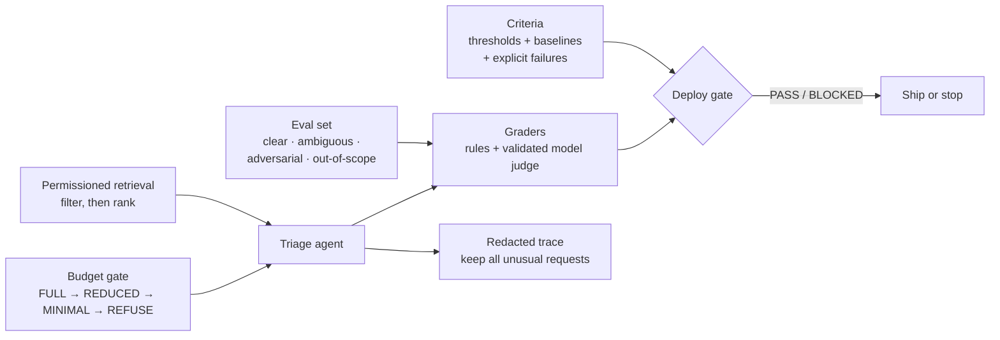

# Production Gate

**The apparatus that makes an LLM agent approvable for production: success criteria written before the code, an eval set built around the hard cases, validated graders, retrieval that can't leak documents across roles, budgets enforced before each call, redacted traces, and a deploy gate that blocks regressions.**

Getting an agent demo working is the easy part. Getting it approved means answering: what does "good" mean, measured how, against what baseline? Can a user ever see a document their role can't access? What happens to cost under a traffic spike? Can you explain a bad decision from last Tuesday? This project answers those for one deliberately narrow workflow — triaging support tickets into a category and priority, citing the policy that justifies the priority.



## What's here

**Criteria before code** (`criteria/definition.py`). Five criteria — categorization accuracy, policy-citation rate, p95 latency, cost per ticket, escalation precision — each with a threshold, a direction, a baseline, and how it's measured (eval score, production signal, or human review). Unacceptable outcomes are listed explicitly so borderline results aren't negotiated at review time.

**An eval set that can detect failure** (`evals/build.py`). Target composition of 40% clear, 30% ambiguous, 20% adversarial, 10% out of scope; at least 15 cases per category; every adversarial case must state its attack. Seed attacks include prompt injection, priority inflation through urgency language, and a false claim of a prior refund agreement. Holdout assignment is a stable hash of the case ID, so adding cases never reshuffles the split.

**Graders, validated** (`graders/`). Anything checkable by rule is a rule: valid category, a citation that parses *and* resolves to a real document, and no reference to documents the user can't access. Judgment calls use a model grader, which is only usable after validation against at least 40 human labels with ≥ 90% agreement and ≤ 3% false passes — tracked separately, because false passes are the dangerous direction.

**Retrieval that filters before it ranks** (`retrieval/permissioned.py`). Visibility is computed from the user's roles and explicit grants, then search runs only over that subset. Filtering *after* ranking would leak through result counts and ranking displacement. Precomputed per-role masks keep the check cheap.

**Authorization at execution** (`agent/loop.py`). Tools a user can't invoke are hidden from the model *and* rejected at call time against the user's identity, never a service identity. The loop checks a request-wide deadline before each step and returns a partial result routed to a human rather than overrunning.

**Budgets that act, not dashboards** (`ops/budget.py`). Per-tenant rolling hourly spend picks the richest tier the remaining headroom affords, keeping a 10% reserve; below the cheapest tier, the request is refused and queued for a human.

**Operable traces** (`ops/trace.py`). Customer content is replaced by a fingerprint and stripped on output regardless of caller. Every unusual request — partial, refused, urgent, unauthorized tool call, tool error, expensive, slow — is retained; the rest are sampled deterministically.

**The gate** (`gate/check.py`). Security failures block with no tolerance; criteria are checked in their own direction; aggregate eval score may not drop more than 0.015; mismatched grader versions invalidate the comparison. Every run reports the business numbers next to the eval score.

## Example

The gate on a candidate with one document leak, a precision miss, and a score drop:

```text
[BLOCKED]
  BLOCK   SECURITY: no_document_leak failed on 1 case(s). No tolerance applies.
  BLOCK   escalation_precision: 0.93 fails threshold 0.95
  BLOCK   eval score dropped 0.022 (0.912 -> 0.890)
  note    eval 0.890 | tickets auto-triaged 72.0% | human corrections 6.0% | cost/ticket $0.0140
```

And the budget ladder for a tenant with a $1.00/hour limit: $0.00 or $0.88 spent → `full`; $0.895 → `minimal`; $0.90 → `refuse`. (The inputs here are hand-written test values; the output is real.)

## Quick start

Requires Python 3.10+.

```bash
git clone https://github.com/AliAzamat/production-gate.git
cd production-gate
pip install numpy pytest

python -m pytest -q    # 5 access-boundary tests
```

## Limitations

See [docs/WHAT_THE_GATE_MISSES.md](docs/WHAT_THE_GATE_MISSES.md) for what the gate deliberately does not catch: novel attacks, distribution shift, provider-side model drift, gradual cost creep, and grader drift.

In the code itself:

- These are components, not a deployed service — there's no model client, eval runner that produces the gate's input, or entry point wiring them together.
- The baseline values in `criteria/definition.py` are documented with how they *would* be measured; no labeled dataset or measurement data is included.
- Tests cover the access boundary only; there's no dependency file.
